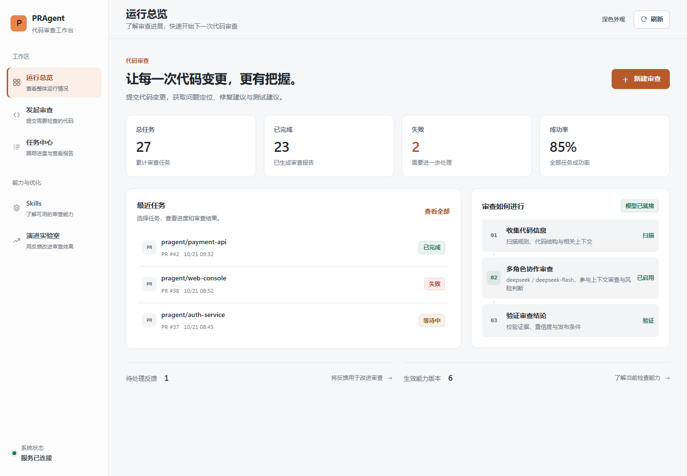
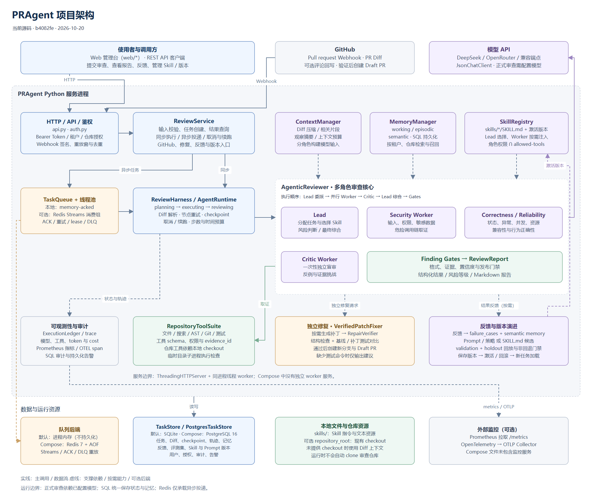
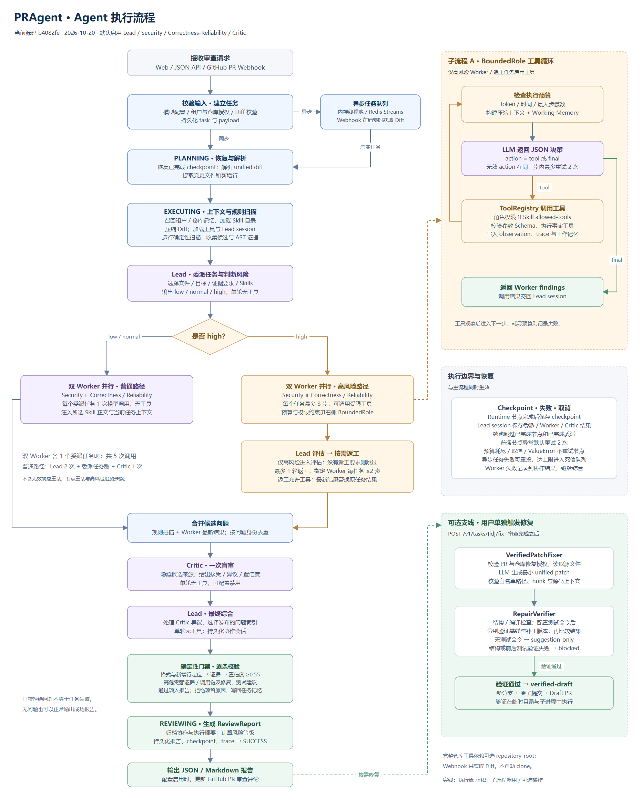
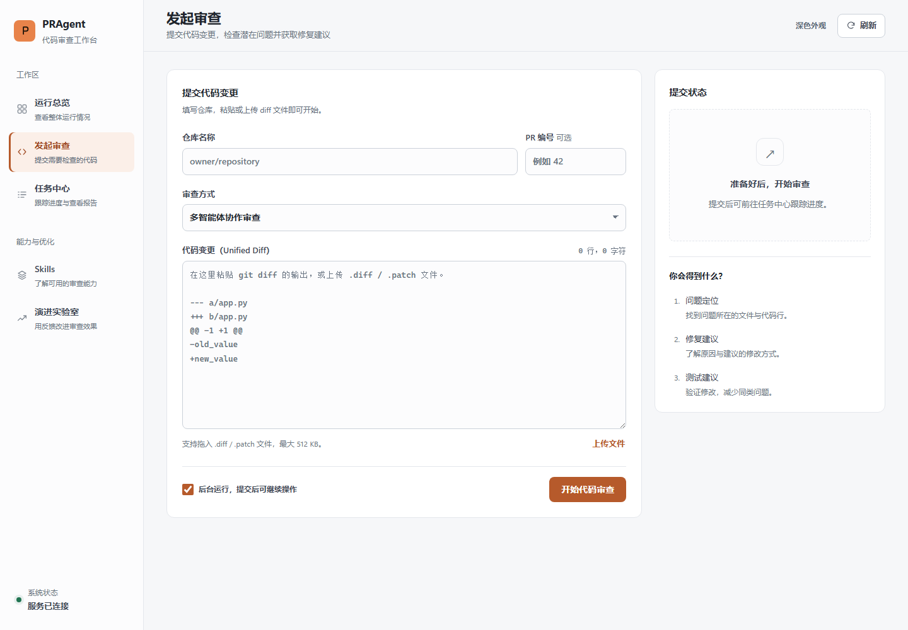
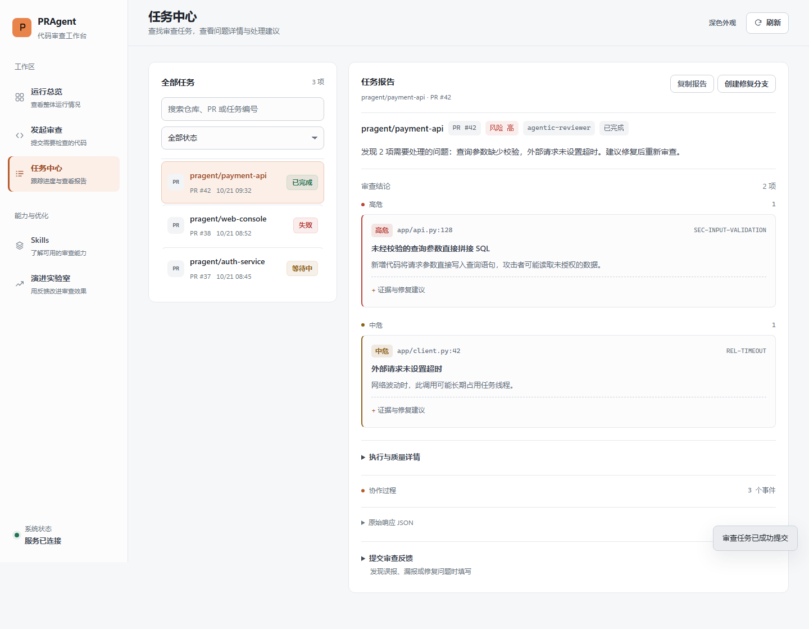
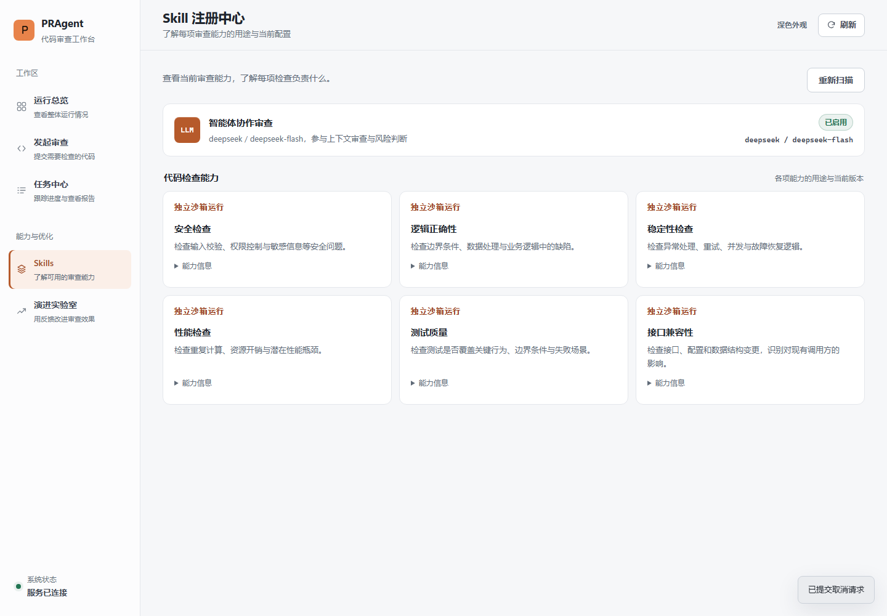
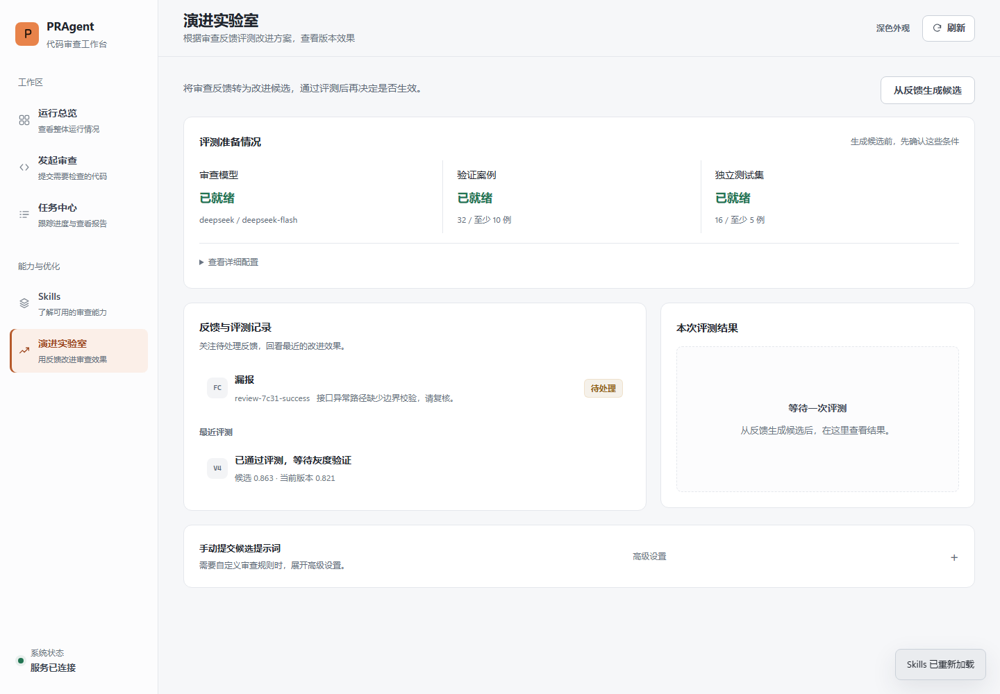
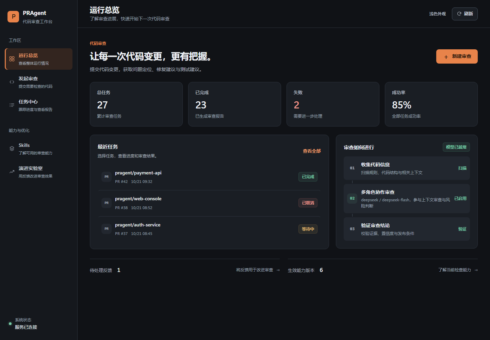
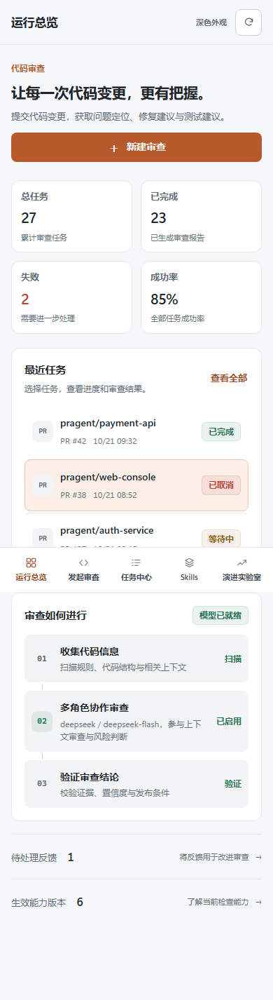

# PRAgent 多智能体代码审查

PRAgent 把一次代码审查拆成一场可审计的多 Agent 协作：Lead 判定风险并分配任务，安全与正确性/可靠性两个 Worker 用本次变更涉及的文件与 diff 取证，Critic 盲审挑战结论，最后所有 finding 必须通过证据与置信度门禁才能发布。审查结果既回写 PR，也留在控制台里可追踪、可反馈、可回流成下一次的改进。

正式审查入口是 `agentic` 模式，一次普通任务固定 5 次模型调用；高风险任务允许一轮 Worker 返工。每次调用的 token、耗时、证据引用与门禁结论都写进任务轨迹，报告里能直接看到钱花在哪、结论凭什么成立。



## 核心能力

审查执行：

- 统一 diff 解析，只定位新增代码与新文件行号，输出结构化问题、修复建议和测试建议
- Agentic 协作：Lead + Security + Correctness/Reliability + Critic，高风险最多一轮返工
- 带 Tool Registry、参数 Schema 校验和结构化 Observation 的 Agent Loop，Worker 可按需读文件全文、查符号定义与调用点、定位相关测试
- 文件上下文：webhook 与轮询审查按被审提交的 SHA 读取本次变更涉及的文件全文，没有本地 checkout 也能看到完整函数而不只是 diff 片段；改动文件之外的调用方不在这个范围内
- 自研 Agent Runtime：持久化 checkpoint、执行预算、任务断点续跑与取消
- 质量门禁：格式、精确位置证据、强证据引用、置信度与发布条件，未通过的候选会在报告里单独披露

集成与交付：

- GitHub `pull_request` webhook（`opened`、`reopened`、`synchronize`），HMAC-SHA256 签名校验、幂等投递、重放时间窗与评论 upsert
- 可选的 PR 评论回写；自动修复走独立的 Draft PR，只覆盖可确定安全的规则，验证通过后才提交到 `pragent/fix-pr-*` 分支
- LLM unified patch、AST/CST、沙箱前后测试对比构成的修复闭环

平台与运维：

- Web 控制台：任务总览、发起审查、任务中心、Skills 清单、演进实验室，支持浅色/深色外观与移动端
- SQLite 本地模式，PostgreSQL + Redis Streams 生产模式（ACK、租约、指数退避重试、死信队列）
- 用户登录、RBAC、租户/仓库隔离与不可变审计日志
- 动态 Skill manifest 校验、签名校验与隔离进程沙箱；Skill 版本可评测、门禁、激活与回滚
- 失败案例回流、提示词与 Skill 演进评测、灰度发布与影子流量
- OpenTelemetry Trace、Prometheus 指标与持久化告警

## 架构





两张图都有 draw.io 可编辑源文件与 SVG 矢量版本，说明见 [`image/README.md`](image/README.md)。图依据提交 `b4082fe` 绘制，之后的门禁语义与报告输出有调整，主干流程未变。

```text
HTTP / GitHub Webhook
        │
        ▼
 ReviewService ── TaskStore(SQLite / PostgreSQL)
        │
        ▼
        ReviewHarness (PRAgent Runtime / checkpoint / resume / budget / trace)
        │
        ├── DiffParser
        ├── Redis Streams / ACK / lease / retry / DLQ
        └── Agentic Lead/Workers
              ├── Lead：一次任务分配并判定风险；高风险时最多请求一轮返工；最终综合
              ├── Security Worker：输入/权限/敏感数据/危险调用链
              ├── Correctness/Reliability Worker：状态/异常/并发/资源/兼容性
              ├── Critic Worker：一次性盲审、反例与证据挑战
              └── Gates：格式、证据、置信度和发布门禁
```

## Web 控制台

服务启动后打开 `http://127.0.0.1:8080/`。前端是零构建的静态资源（`web/` 目录直接由 API 进程托管），不需要 Node 工具链；业务 API 返回未授权状态后弹登录层，登录状态保存在当前浏览器的 `localStorage` 中。

| 页面 | 用途 |
|---|---|
| 运行总览 | 任务量、成功率、未解决反馈与 Skill 版本概况，最近任务一键进入报告 |
| 发起审查 | 粘贴或拖入 diff 文件，实时统计行数与字符数，按需放入异步队列 |
| 任务中心 | 按仓库、PR 编号与状态搜索筛选；报告默认优先展示问题，执行详情、预算与门禁事实可展开 |
| Skills | 查看已加载的审查能力、用途与允许工具，可触发重新扫描 |
| 演进实验室 | 从反馈生成候选版本，查看评测门禁结论与激活状态 |
| 使用说明 | 内嵌的使用手册，覆盖从第一次审查到读懂报告、处理反馈与接入 GitHub |

控制台里的"使用说明"读的是仓库中的 [`docs/USER_GUIDE.md`](docs/USER_GUIDE.md)，由 `/guide` 端点按原样返回、前端就地渲染。手册只有这一份文件，改完刷新页面即可看到新内容，不需要同步两份文案。

<table>
<tr>
<td></td>
<td></td>
</tr>
<tr>
<td></td>
<td></td>
</tr>
<tr>
<td></td>
<td></td>
</tr>
</table>

页面支持系统外观跟随与手动主题切换（刷新后保持）、键盘可达的跳转链接与焦点管理，`1366 / 1280 / 1024 / 768 / 390 / 360` 六种宽度下无横向溢出。

## 两种自动审查的接入方式

PRAgent 有两条独立的路把"有人提了 PR"变成"开始审查"。它们的前置条件完全不同，按你手上有什么来选，也可以同时开启。

| | 轮询（默认） | Webhook |
|---|---|---|
| 触发方式 | 后台线程定时扫描 open PR | GitHub 主动推送事件 |
| 时延 | 分钟级，默认 180 秒 | 秒级 |
| 前置条件 | 一个 GitHub 令牌 | 一个 GitHub 能访问到的公网 HTTPS 地址 |
| 需要公网地址或域名 | 不需要 | 需要 |
| 进程停机期间产生的事件 | 下一轮扫描补上，不会丢 | 丢失，重投窗口只有 600 秒 |
| 适合的运行位置 | 个人电脑、内网、笔记本 | 常驻的公网服务器 |

### 方式一：轮询（`start.bat` 一键启动）

不需要公网地址、域名或隧道，只需要能出网。这是单机使用的默认方式。

1. 双击 `start.bat`。它会定位 Python（优先 `runtime\python\python.exe`，其次系统 Python 3.11+），把工作目录固定到脚本所在位置，启动服务并打开浏览器。
2. 向导第一步填模型：接口地址、模型名、API Key，点"测试并保存"。保存时会真实调用一次接口，通过后立即生效，不用重启。
3. 向导第二步连 GitHub：自动识别本机 GitHub CLI 登录，识别不到就粘贴一个具备 `repo` 权限的令牌，两条路等价。
4. 向导第三步勾选仓库并保存。后台线程开始按间隔扫描这些仓库的 open PR。

之后有人提 PR，下一轮扫描就会创建审查任务，结论回写到该 PR 的评论。

**怎么确认它在工作**：`GET /api/dashboard` 的 `polling` 字段有 `ticks`（已经扫描的轮数）和 `last_summary`（本轮提交了几次审查、跳过几次重复）。`GET /v1/onboarding/status` 的 `watches[].last_sha` 是每个仓库最近一次已提交审查的 commit。

轮询的幂等键是 `(仓库, head commit)`。同一个 PR 没有人推新提交就不会被重复审查；推了新提交才会重新审，因为审查对象是代码不是 PR 编号。已关闭的 PR 不再出现在 `state=open` 的列表里，自然不再扫描。

### 方式二：Webhook（秒级）

需要 `PRAGENT_PUBLIC_BASE_URL` 是一个公网 HTTPS 地址，因为 GitHub 要主动往这个地址 POST 事件。

1. 确认 `PRAGENT_PUBLIC_BASE_URL` 是公网 HTTPS。仍是 `http://127.0.0.1:8080` 或私有网段时，向导会把 webhook 区域显示为不可用并说明原因，而不是让你配一个收不到事件的地址。
2. 在向导里生成 Secret。页面同时给出完整的 Payload URL。
3. 打开目标仓库的 Settings → Webhooks → Add webhook：
   - Payload URL 填向导给出的地址，形如 `https://<你的域名>/webhooks/github`
   - Content type 选 `application/json`
   - Secret 填上一步生成的值
   - 事件只勾 Pull requests
4. 点向导里的"等待首个事件"，然后在仓库里开一个 PR。收到事件后页面会显示投递编号，说明这条链路通了。

公网转发、fine-grained PAT 的权限范围、以及不开向导时纯环境变量的配法，见下方 [GitHub Webhook](#github-webhook) 章节。`/webhooks/github` 用 HMAC 签名认证，不走用户登录，所以开启 `PRAGENT_AUTH_REQUIRED` 也不会把它挡住。

### 同时开启会怎样

不冲突，也不重复审查。轮询和 webhook 共用同一个去重键 `(租户, 仓库, head commit)`，谁先到谁创建任务，后到的那个记一次重复就跳过。

推荐同时开启：webhook 负责秒级响应，轮询负责补齐 webhook 漏掉的事件——进程重启、网络抖动、超过 600 秒重投窗口的投递，都只有轮询能兜住。

### 两种方式都不用手改环境变量

向导写入的配置保存在数据库里（`runtime_settings` 与 `repository_watches` 两张表），不写回 `.env`。这些值包含模型密钥与 GitHub 令牌，应按凭据文件对待。

要注意进程环境变量优先于 `.env`：如果 shell 里已经 export 了 `PRAGENT_AUTO_POST_REVIEW` 之类的变量，`.env` 里的同名值不会生效。判断实际生效值用 `GET /v1/onboarding/status`，它读的是运行中的配置。

### 自动扫描的开关

| 变量 | 默认 | 作用 |
|---|---|---|
| `PRAGENT_WATCH_POLL_ENABLED` | `true` | 关闭后台轮询线程 |
| `PRAGENT_WATCH_POLL_INTERVAL_SECONDS` | `180` | 轮询间隔，向导里保存的值优先 |

单个仓库轮询失败不会影响其他仓库，失败原因记录在该仓库的 `last_error` 字段里，可以从 `GET /v1/onboarding/status` 查看。

## 快速开始

项目使用 Python 3.11。先安装锁定范围内的运行依赖，并在同一个 PowerShell 窗口中配置本地管理员：

```powershell
python -m pip install -r requirements.txt

$bytes = New-Object byte[] 32
[Security.Cryptography.RandomNumberGenerator]::Create().GetBytes($bytes)
$env:PRAGENT_AUTH_REQUIRED = 'true'
$env:PRAGENT_AUTH_SECRET = [Convert]::ToBase64String($bytes)
$env:PRAGENT_BOOTSTRAP_ADMIN_USERNAME = 'admin'
$env:PRAGENT_BOOTSTRAP_ADMIN_PASSWORD = '<替换为至少 10 个字符的密码>'

python -m pragent
```

不要直接使用示例占位符作为密码或密钥。环境变量只对当前 PowerShell 及其子进程生效；修改配置后需要停止并重新启动 PRAgent。服务可以在未配置模型时启动并提供健康检查，但提交审查前必须按下方“模型配置”章节配置模型。

Bootstrap 管理员只在用户名尚不存在时创建；已有同名用户的密码不会在重启时被覆盖。

服务默认监听 `127.0.0.1:8080`。API 调用需要先登录并携带 Bearer Token：

```powershell
$session = Invoke-RestMethod -Method Post -Uri http://127.0.0.1:8080/v1/auth/login `
  -ContentType 'application/json' `
  -Body (@{username='admin'; password='<你的密码>'} | ConvertTo-Json)
$headers = @{Authorization="Bearer $($session.access_token)"}
Invoke-RestMethod -Method Post -Uri http://127.0.0.1:8080/v1/reviews `
  -Headers $headers `
  -ContentType 'application/json' `
  -Body (@{
    repository = 'demo/api'
    pull_request = 12
    mode = 'agentic'
    diff = "diff --git a/app.py b/app.py`n--- a/app.py`n+++ b/app.py`n@@ -1 +1,2 @@`n+password = 'secret'`n+eval(user_input)"
  } | ConvertTo-Json)
```

查询任务：

```powershell
Invoke-RestMethod -Headers $headers http://127.0.0.1:8080/v1/tasks/<task-id>
Invoke-WebRequest -Headers $headers http://127.0.0.1:8080/v1/tasks/<task-id>/report
```

运行测试：

```powershell
python -m unittest discover -s tests -v
```

## Docker 一键部署

需要 Docker Engine / Docker Desktop（含 Compose v2）。脚本会生成随机强密钥的 `.env`、构建镜像、启动 PostgreSQL + Redis + PRAgent 三个容器，并在 `/health` 通过后打印访问地址与登录凭据。

```powershell
powershell -ExecutionPolicy Bypass -File deploy.ps1   # Windows PowerShell 5.1
pwsh -File deploy.ps1                                 # PowerShell 7
```

Linux / macOS：

```bash
./deploy.sh
```

常用参数：

```powershell
powershell -ExecutionPolicy Bypass -File deploy.ps1 -Port 9080
powershell -ExecutionPolicy Bypass -File deploy.ps1 -PipIndexUrl https://pypi.tuna.tsinghua.edu.cn/simple
powershell -ExecutionPolicy Bypass -File deploy.ps1 -PythonImage python:3.12-slim   # 复用本地已有基础镜像
powershell -ExecutionPolicy Bypass -File deploy.ps1 -Recreate                       # 重新生成密钥（旧 .env 自动备份）
powershell -ExecutionPolicy Bypass -File deploy.ps1 -NoBuild                        # 复用已有镜像
```

也可以直接使用 Compose（需自行准备 `.env`，否则使用不安全的 `dev-only` 默认密钥）：

```powershell
docker compose up -d --build
docker compose logs -f pragent
docker compose down          # 停止；数据保留在命名卷中
```

部署要点：

- 容器内强制 `PRAGENT_HOST=0.0.0.0`、端口 `8080`、`PRAGENT_SKILLS_DIR=/app/skills`，即使 `.env` 里写了宿主机用的 `127.0.0.1` 也不会影响容器内监听。
- 启用 PostgreSQL 与 Redis Streams 队列；`.env` 中的模型与 GitHub 配置会通过 `env_file` 注入容器，镜像内默认为 `local` 规则审查模式。`agentic` 模式必须先在 `.env` 配好模型，否则提交审查会返回 `agentic review requires a configured model`。
- 进程以非 root 用户（uid 10001）运行，镜像自带 `/health` 健康检查，`docker compose ps` 可直接看到 healthy 状态。
- 持久化：`postgres_data`（任务与审计）、`redis_data`（队列 AOF）、`pragent_data`（SQLite 回退库与临时产物）。
- 修改 `.env` 中的模型配置后需 `docker compose up -d` 让容器重建以生效。
- Bootstrap 管理员只在用户名不存在时创建；数据库卷初始化后再改 `PRAGENT_POSTGRES_PASSWORD` 不会生效，需先删除 `pragent_postgres_data` 卷。
- 构建期可用 `PIP_INDEX_URL` 切换 pip 源、`PYTHON_IMAGE` 替换基础镜像（受限网络或离线场景）。

## 模型配置

DeepSeek 官方 API（按 Token 计费）。模型名必须显式指定为 `deepseek-flash` 或 `deepseek-v4-pro`：内置默认值 `deepseek-v4-flash` 对应的模型已下线（旧名仍被接受并由 DeepSeek-V4.1-Flash-1017 承接），显式声明可避免版本漂移：

```powershell
$env:PRAGENT_LLM_PROVIDER = 'deepseek'
$env:PRAGENT_DEEPSEEK_API_KEY = '<deepseek-api-key>'
$env:PRAGENT_LLM_MODEL = 'deepseek-flash'
python -m pragent
```

`deepseek-flash` 默认开启思考模式（`thinking.type=enabled`，`reasoning_effort=high`），思维链与最终答案共享 completion 预算。项目的每次调用默认输出上限 4000 tokens，推理量大时 JSON 答案会被挤空（表现为 `lead returned an invalid action` 或工人返回空白）。生产接入推理模型时按需放宽：

```powershell
$env:PRAGENT_LLM_REASONING_EFFORT = 'low'        # disabled 之外的最低思考强度
$env:PRAGENT_AGENT_MAX_OUTPUT_TOKENS = '8000'    # 单次调用输出上限
$env:PRAGENT_AGENT_TOKEN_BUDGET = '24000'        # 每个 Agent 角色的累计预算
$env:PRAGENT_AGENT_REVIEW_TOKEN_BUDGET = '120000' # 整次审查（所有角色+返工）的上限
```

角色级预算约束不了整次审查：Lead 有多个阶段，Worker 可能返工，Critic 还要再调用一次。
`PRAGENT_AGENT_REVIEW_TOKEN_BUDGET`、`PRAGENT_AGENT_REVIEW_TIME_BUDGET_SECONDS`、
`PRAGENT_AGENT_REVIEW_MAX_MODEL_CALLS` 是整次审查共享的硬上限，耗尽即中止并把原因写进任务错误与
`execution.review_budget`。留 0 时按角色预算推导（tokens ×6、秒数 ×8，覆盖五到九次调用的正常
范围），调用次数不限。

需要完全关闭思考（结构化 JSON 任务通常足够）时设 `PRAGENT_LLM_THINKING=disabled`。这两个参数默认不发送，非 DeepSeek 的 OpenAI 兼容端点不受影响。

通过 OpenRouter 使用有速率限制、可用性可能变化的 DeepSeek 免费模型：

```powershell
$env:PRAGENT_LLM_PROVIDER = 'openrouter-deepseek-free'
$env:PRAGENT_OPENROUTER_API_KEY = '<openrouter-api-key>'
python -m pragent
```

如果指定的免费 DeepSeek 版本下线，可将 `PRAGENT_LLM_MODEL` 改为 OpenRouter 当前提供的其他 `:free` 模型，或把 Provider 改为 `openrouter-free` 让免费路由自动选择可用模型。

任意其他 OpenAI Chat Completions 兼容端点使用 `custom`：

```powershell
$env:PRAGENT_LLM_PROVIDER = 'custom'
$env:PRAGENT_LLM_BASE_URL = 'https://example.com/v1'
$env:PRAGENT_LLM_API_KEY = '<token>'
$env:PRAGENT_LLM_MODEL = '<model-name>'
```

密钥只通过环境变量读取，不要提交到仓库。

项目启动时会自动读取项目根目录的 `.env`，也兼容 `pragent/.env`；系统环境变量优先于 `.env` 文件。推荐将以下内容写入根目录 `.env`（该文件已被 `.gitignore` 忽略）：

```env
PRAGENT_LLM_PROVIDER=deepseek
PRAGENT_DEEPSEEK_API_KEY=你的真实APIKey
```

## GitHub Webhook

项目使用“GitHub 仓库 Webhook + 公网转发 + fine-grained PAT”接收 PR 事件，不需要创建或安装 GitHub App：

```text
GitHub Pull request 事件
        │
        ▼
https://<公网域名>/webhooks/github
        │  公网转发
        ▼
http://127.0.0.1:8080/webhooks/github
        │
        ▼
PRAgent 创建异步审查任务
```

### 1. 配置 PRAgent

先生成一个 Webhook Secret，并根据需要配置 GitHub fine-grained personal access token：

```powershell
$webhookBytes = New-Object byte[] 32
[Security.Cryptography.RandomNumberGenerator]::Create().GetBytes($webhookBytes)
$env:PRAGENT_GITHUB_WEBHOOK_SECRET = [Convert]::ToBase64String($webhookBytes)

# 私有仓库、PR 评论回写或自动修复需要；只审查公开仓库且不回写时可以不配置。
$env:PRAGENT_GITHUB_TOKEN = '<GitHub fine-grained PAT>'

# 默认关闭。设为 true 后，审查完成时更新或创建 PR 评论。
$env:PRAGENT_AUTO_POST_REVIEW = 'true'

python -m pragent
```

Webhook Secret 用于验证 GitHub 请求头中的 HMAC-SHA256 签名，不能与登录用的 `PRAGENT_AUTH_SECRET` 混用。Webhook 请求不携带管理台 Bearer Token；`/webhooks/github` 使用签名而不是用户登录进行认证。

fine-grained PAT 只授权需要接入的仓库，并按功能授予最小权限：

- 读取私有仓库 PR Diff：`Contents: Read`、`Pull requests: Read`；
- 回写审查评论：`Pull requests: Read and write`；
- 创建自动修复分支和提交：`Contents: Read and write`、`Pull requests: Read and write`。

只接收 Webhook 但不访问私有仓库、不回写评论且不执行自动修复时，可以不设置 PAT。密钥必须在启动 PRAgent 前设置，修改后需要重启服务。

Docker 部署时上述变量写入 `.env`，改完执行 `docker compose up -d` 让容器重建。同时把 `PRAGENT_PUBLIC_BASE_URL` 设为当前公网域名，否则 GitHub App 安装回调与报告中生成的链接会指向 `127.0.0.1`。

### 2. 建立公网转发

GitHub 无法访问 `127.0.0.1`，需要把公网 HTTPS 地址转发到本地 `http://127.0.0.1:8080`。任选一种已安装的转发工具，例如：

```powershell
# Cloudflare Quick Tunnel
cloudflared tunnel --url http://127.0.0.1:8080

# 或 ngrok
ngrok http 8080
```

命令启动后会显示一个形如 `https://example.trycloudflare.com` 或 `https://example.ngrok-free.app` 的公网 HTTPS 地址。保持 PRAgent 和转发进程同时运行。临时公网地址通常会在转发工具重启后变化，变化后必须同步更新 GitHub Webhook 的 Payload URL。

上述快捷转发会把 8080 端口上的管理台和 API 一并暴露到公网，因此必须保持 `PRAGENT_AUTH_REQUIRED=true`，并使用强管理员密码和随机 `PRAGENT_AUTH_SECRET`。长期部署建议通过反向代理只公开 `/webhooks/github`（以及按需公开 `/health`），不要向公网暴露整个管理台。

#### 带白名单网关的 quick tunnel

仓库自带 `tunnel-quick.ps1`，把“只放行必要路径的网关 + quick tunnel + 回写 `.env` + 重建容器”整条链路串起来，避免把整个管理台暴露到公网：

```powershell
# 启动网关(默认 8081) → cloudflared → 校验公网 /health → 写 PRAGENT_PUBLIC_BASE_URL → 重建 pragent 容器
powershell -ExecutionPolicy Bypass -File tunnel-quick.ps1

# 只改 .env，不重建容器
powershell -ExecutionPolicy Bypass -File tunnel-quick.ps1 -SkipCompose

# 停止网关与隧道
powershell -ExecutionPolicy Bypass -File tunnel-quick.ps1 -Stop
```

隧道前面的 [`tunnel-gateway.js`](tunnel-gateway.js) 默认只转发 `/webhooks/github` 与 `/health`，其余路径直接返回 404 并记录到 `tunnel-access.log`；需要公网管理台时加 `-ExposeAdmin`。脚本需要 `cloudflared`（默认 `D:\cloudflared\cloudflared.exe`，可用 `-CloudflaredPath` 改）与 Node.js，本地端口从 `.env` 的 `PRAGENT_HTTP_PORT` 读取。

quick tunnel 的域名每次启动都会变，脚本会把新地址写回 `.env` 的 `PRAGENT_PUBLIC_BASE_URL`，但 GitHub 上的 Payload URL 仍需手动同步。

#### 长期稳定的 named tunnel

quick tunnel 的域名随机且进程一停就失效，只适合一次性验证。需要固定地址时用绑定自有域名的 named tunnel，项目自带脚本把整条链路自动化：

```powershell
# 一次性：浏览器授权，把 origin 证书写入 ~/.cloudflared/cert.pem
& 'D:\cloudflared\cloudflared.exe' tunnel login

# 创建/复用隧道、绑定 DNS、写 config.yml、注册自启、回写 .env 并验证
powershell -ExecutionPolicy Bypass -File tunnel.ps1 -Hostname agent.example.com

# 装成原生 Windows 服务（更稳，需要管理员 PowerShell）
powershell -ExecutionPolicy Bypass -File tunnel.ps1 -Hostname agent.example.com -InstallService
```

前提是域名已托管在 Cloudflare。脚本默认只放行 `/webhooks/github` 与 `/health`，其余路径返回 404，管理台仍然只能从 `127.0.0.1:8080` 访问；需要公网管理台时加 `-ExposeAdmin`。无管理员权限时会退化为注册一个开机自启、失败自动重启的计划任务。

### 3. 在 GitHub 仓库中添加 Webhook

进入目标仓库的 **Settings → Webhooks → Add webhook**，填写：

- **Payload URL**：`https://<公网域名>/webhooks/github`；
- **Content type**：`application/json`；
- **Secret**：与 `PRAGENT_GITHUB_WEBHOOK_SECRET` 完全相同；
- **SSL verification**：保持启用；
- **Which events would you like to trigger this webhook?**：选择 **Let me select individual events**，只勾选 **Pull requests**；
- **Active**：保持勾选。

PRAgent 会处理 `opened`、`reopened` 和 `synchronize` 三种 PR 动作；其他 `pull_request` 动作会正常接收但被忽略。服务会根据 payload 中的 `diff_url` 下载 Diff，并异步创建审查任务。

### 4. 验证连接

先确认本地服务和公网地址都能访问健康检查：

```powershell
Invoke-RestMethod http://127.0.0.1:8080/health
Invoke-RestMethod https://<公网域名>/health
```

然后新建 PR、重新打开 PR，或向 PR 推送一次提交。在 GitHub 的 **Settings → Webhooks → Recent Deliveries** 中应看到 `/webhooks/github` 返回 `202`；管理台的任务中心随后会出现对应审查任务。如果失败，优先检查公网转发进程是否仍在运行、Payload URL 是否包含 `/webhooks/github`、Secret 是否一致，以及 PAT 是否有目标仓库权限。

默认只在管理台保存结果。只有 `PRAGENT_AUTO_POST_REVIEW=true` 时才会向 PR 回写评论。

## 质量门禁与报告

每条候选结论在落地前都要过 FindingGate，未通过的候选不会静默消失，报告会把它们单独列出来：

- 格式门禁：严重性、文件路径、行号、修复建议缺一不可；
- 位置证据：finding 指向的行必须能在新增代码里对上；
- 证据门禁：高风险结论需要 AST、扫描器或调用链证据，且引用必须回溯到真实工具调用；
- 置信度门禁：低于阈值的候选不发布；但如果 Lead 已经看过 Critic 的反对意见并明确选择发布，这一判断会被记录（`lead_accepted`）并优先于阈值，避免整场协作的结论在最后一步被无声丢弃；
- 发布门禁：`critical`/`high` 结论还要求对应等级的验证记录。

Markdown 报告的协作摘要统计的是 Critic 之前的候选数（`candidate_findings_before_critic`），与被拦下的数量分开计数。当所有候选都被门禁挡下时，报告不再输出“没发现问题”，而是列出每条候选及其拦截原因——一份空的审查报告和一份干净的审查报告必须能区分开。控制台的任务详情会把这些事实渲染成门禁卡片：位置证据是否命中、强证据数、已验证/未验证引用数与最终结论。

自动修复只覆盖可确定安全的规则，例如调试输出、`shell=True` 和硬编码 Python 凭据；结果始终提交到新的 `pragent/fix-pr-*` 分支，不直接修改源分支。

## API

| 方法 | 路径 | 说明 |
|---|---|---|
| `GET` | `/health` | 健康检查 |
| `POST` | `/v1/auth/login` | 登录并获取租户绑定的短期 Bearer Token |
| `POST` | `/v1/reviews` | 创建同步审查任务 |
| `POST` | `/v1/reviews?async=true` | 创建异步审查任务 |
| `GET` | `/v1/tasks/{id}` | 获取状态、轨迹和报告 |
| `GET` | `/v1/tasks/{id}/report` | 获取 Markdown 报告 |
| `GET` | `/v1/tasks/{id}/feedback` | 获取该已完成任务的反馈历史 |
| `POST` | `/v1/tasks/{id}/fix` | 创建自动修复分支和提交 |
| `POST` | `/v1/tasks/{id}/feedback` | 回流误报、漏报或坏修复 |
| `POST` | `/v1/tasks/{id}/cancel` | 请求取消任务 |
| `POST` | `/v1/tasks/{id}/resume` | 从最近 checkpoint 续跑任务 |
| `POST` | `/webhooks/github` | 接收 GitHub PR webhook |
| `POST` | `/v1/skills/reload` | 动态重新加载 Skill |
| `POST` | `/v1/evolution/auto` | 从失败案例生成并评测提示词版本 |
| `POST` | `/v1/evolution/propose` | 评测指定提示词候选版本 |
| `GET/POST` | `/v1/evaluation/cases` | 查询或增加版本化评测样本 |
| `GET` | `/v1/evolution/status` | 查询模型与评测门禁就绪状态 |
| `GET` | `/v1/evolution/runs` | 查询持久化的新旧版本评测记录 |
| `POST` | `/v1/skills/{name}/versions/{version}/activate` | 激活或回滚版本 |
| `POST` | `/v1/skill-evolution/auto` | 从确认反馈生成、回放并门禁 Skill 候选 |
| `POST` | `/v1/skill-evolution/propose` | 评测指定 Agent Skill `SKILL.md` artifact |
| `GET` | `/v1/skill-evolution/status?skill_name={name}` | 查询 Skill 门禁与激活版本 |
| `GET` | `/v1/skill-evolution/runs` | 查询 Skill 进化运行与指标 |
| `GET` | `/v1/skill-evolution/{name}/versions` | 查询 Skill artifact 版本链 |
| `POST` | `/v1/skill-evolution/{name}/versions/{version}/activate` | 激活或回滚 Skill artifact |
| `GET` | `/metrics` | Prometheus 文本指标 |
| `GET` | `/api/alerts` | 查询租户告警 |
| `GET` | `/api/audit` | 查询租户审计日志 |
| `GET` | `/api/queue/dead-letters` | 查询死信任务 |
| `POST` | `/v1/queue/dead-letters/replay` | 重放死信任务 |
| `GET/POST` | `/api/deployments/llm-review`、`/v1/deployments/llm-review` | 查询或配置灰度/影子发布 |

`POST /v1/reviews` 的 `diff` 最大默认 1 MiB；单任务默认最多 8 步、120 秒。可通过环境变量调整，详见 `.env.example`。`cancel`、`resume`、`skills/reload`、死信重放这类不需要请求体的 POST 可以直接空 body 调用。

## Skills 的定位与编写方式

`skills/` 下的目录是 Agent Skill 包，不是工具连接器目录。它们目前以审查领域为中心，是因为本项目的产品目标是代码审查；Skill 的职责是把某个领域的判断标准、调查步骤和输出约束注入模型，而不是自己执行 SQL、调用 GitHub 或创建网络连接。

一个 Skill 包至少包含一个 `SKILL.md`：

```text
skills/<skill-name>/
└── SKILL.md                 # YAML 元数据 + 完整运行指令
```

`SKILL.md` 的 frontmatter 由运行时读取：

- `name`：必须与目录名一致，且只使用小写字母、数字和连字符；
- `description`：只用于目录发现和路由，应该短而明确地说明何时启用；
- `allowed-tools`：该 Skill 允许 worker 使用的工具名集合。它是权限声明，不会安装或连接工具；最终权限还会与角色权限取交集；

frontmatter 后的 Markdown 正文才是 Skill 的核心。正文会在 Lead 选中 Skill 后注入对应 worker 的上下文，因此应写成可执行的审查协议，而不是几条标签式提示词。推荐至少包含：任务边界、适用/不适用范围、逐步调查流程、边界条件清单、证据与严重性标准、误报排除规则、修复与验证要求，以及稳定的输出字段。

Skill 可以附带文本资源（例如规范摘录、查询模板或测试清单）。运行时会把资源列入 Skill 包，并仅为已选中的 Skill 注册 `read_skill_resource`；资源不能通过路径穿越或符号链接逃逸出包目录。真正的工具连接由运行时的 `RepositoryToolSuite`、外部集成或插件提供，Skill 只声明“可以使用哪些已经存在的工具”。

运行时流程如下：

```text
磁盘扫描 SKILL.md
        ↓ 只暴露 name/description 给 Lead
Lead 选择相关 Skill
        ↓ 注入 instructions，并收窄 allowed-tools
Worker 使用文件内容与 diff 取证
        ↓
Finding gate 校验格式、证据、置信度和发布条件
```

因此，把 Skill 内容直接硬编码到全局上下文并不能完全等价：那会让每个任务都携带全部领域规则，增加上下文长度和相互干扰；Skill 机制可以按任务选择、限制工具权限、热加载版本，并通过 `/v1/skill-evolution/*` 做候选评测、门禁和回滚。对于只有一两句、没有独立选择价值的规则，直接放在全局 prompt 更合适；只有当一组规则有清晰边界、需要按场景启用或需要独立演进时，才应该做成 Skill。

本仓库的内置 Skill 已按上述结构补充了完整的 Mission、Review procedure、Checklist、Evidence/severity、Remediation/verification 和 Output contract。新增 Skill 时可复制其中一个目录，再根据领域替换这些章节，并用 `POST /v1/skills/reload` 让新任务加载最新版本。

## 项目结构

```text
pragent/                 运行时、编排、门禁、存储与可观测性
├── api.py               HTTP 入口、路由、鉴权与静态资源
├── service.py           审查服务与任务编排
├── harness.py           Runtime 外壳：checkpoint / resume / 预算 / trace
├── agentic_core.py      Lead / Worker / Critic 协作协议
├── gates.py             finding 门禁
├── runtime.py           Agent Loop 与 Tool Registry
├── task_queue.py        Redis Streams 消费、租约与重试
├── store.py             SQLite / PostgreSQL 持久化
└── config.py            环境变量与默认值
skills/                  内置审查 Skill 包
web/                     零构建前端（index.html / app.js / app.css / login.css）
tests/                   unittest 测试集
image/                   架构图（draw.io / PNG / SVG）
docs/screenshots/        控制台截图
scripts/                 评测与实验脚本
deploy.ps1, deploy.sh    Docker 一键部署
tunnel.ps1               固定域名 named tunnel 自动化
tunnel-quick.ps1         quick tunnel + 白名单网关自动化
tunnel-gateway.js        只转发 /webhooks/github 与 /health 的网关
```
